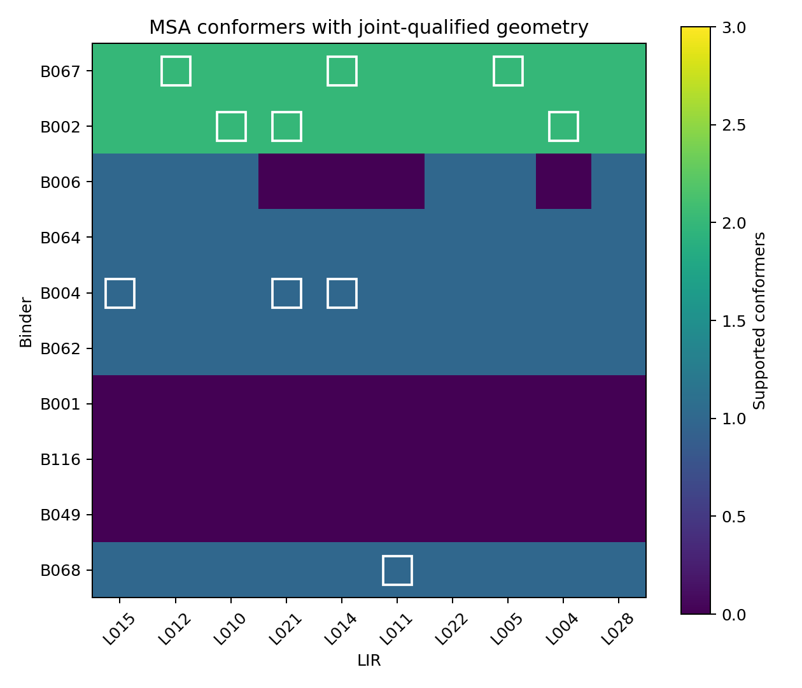
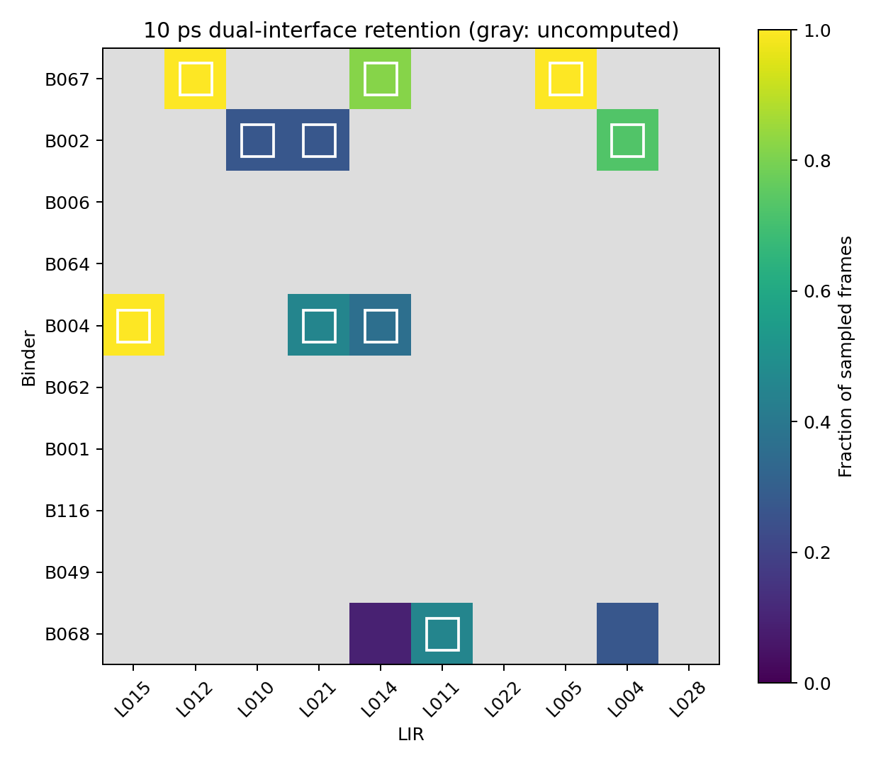

# MSA-SynPep 三模块独立实验报告

运行：bounded_20261013；日期：2026-10-13。全部候选与计算来自本次清空结果后的独立运行。

## 实际完成数量

|项目|数量|
|---|---|
|binder_candidates|120|
|binder_initial_poses|600|
|binder_current_poses|860|
|binder_top10|10|
|LIR_candidates|30|
|LIR_poses_including_controls|99|
|LIR_top10|10|
|fusion_pairs|100|
|linker_schemes|600|
|screen_trajectories|12|
|fusion_top10|10|
|recheck_trajectories|10|

## 方法与生物学范围

输入为三种MSA、两个同蛋白纤维对照及9A1A八个有限单体模型。表面计算使用组装体遮挡，记录三层/五层SASA差异。骨架形状和共同暴露提出四个区域；侧链方向、电荷组及疏水排列作为结构描述输入LLM。系统性抗体表位、竞争结合及当前区域突变标签列为资料缺口。

LLM两批各生成60条10–25 aa结合肽。PepGLAD在双GPU上按批量4条固定序列预测，初筛五纤维各一个姿势。基础几何处理在四个低成本骨架初始化中选择Cα匹配最好的一条，进行30步仅对Cα的扭转角拟合。记录原始坐标、标准化位移和资格。初始20条复核本次第一姿势并补第二姿势，合格序列不足10条时将复核池扩到最多40条；符合条件的提案接受一次20步有限位置调整，平移每轴±1 Å，旋转四元数向量分量±0.06。固定骨架无严重重叠时最多150步GPU侧链最小化。采用标准几何加氢后执行AMBER优化。额外位置调整集中到复核池。

资格覆盖Cα/Ile/Thr手性、允许主链角、C–N偏离<0.05 Å、trans平面偏离<10°、重原子<2 Å严重重叠为0，以及标准化Cα位移≤3 Å。这些是本轮计算阈值。姿势失败保留未知信息。末端方向开放度和延伸点净空是连接空间代理。

LIR以人p62 332–343片段SGGDDDWTHLSS为结构设计模板，固定WTHL，侧翼改变1–3位。首轮单LIR且未修饰。LC3B–p62实验复合物提供核心识别先验，三个侧翼模板样本检查相容性。天然12肽及文献20肽WT、L341V单独作为参考。文献3.2/10.9 μM测量属于20肽构建，L341V为弱结合对照。条件MM/GBSA包含OBC2的ACE表面积溶剂化项，省略构象熵；校准方向与缺失值保留。其他家族成员、修饰依赖和膜环境保持未知。

两个Top10形成100组，每组比较4/8/12残基GSGS及两个模块顺序，每个方案在五纤维上采样8个连接构象。完整模型检查两处界面、源模块资格及LC3B与纤维重叠。按跨MSA合格覆盖、可行比例和连接长度选择每组代表方案。合格三元模型表示空间相容性。

最多20组入围融合肽使用共同MSA靶标和同一协议的10 ps局部模拟：固定纤维重原子、LC3B和融合肽可动、AMBER14/OBC2隐式溶剂、300 K、1 fs。最终10组各做一次独立10 ps复核，记录两处接触与同时保持比例。LLM根据实际观察排序；反转同一池输入再排一次，记录Top10交集。

本次四个区域中心：[58, 43, 94, 85]；融合筛查共同靶标：6XYP。

## 两组Top10与最终Top10

### α-syn结合肽

|名次|编号|完整序列|长度|6XYO合格姿势|6XYP|6XYQ|8A9L|6CU7|合格单体姿势|
|---|---|---|---|---|---|---|---|---|---|
|1|B067|EQTSDNAGKRSPATNQ|16|1|1|1|1|0|0|
|2|B002|NEDSGQETSNQS|12|0|1|1|0|0|0|
|3|B006|SGDQENSTEDQSNTS|15|1|0|1|0|0|0|
|4|B064|QDYTENGSARQST|13|1|2|0|1|0|0|
|5|B004|SDEQPGNEDTQSGS|14|0|2|0|0|0|0|
|6|B062|EQTSDNAGKRS|11|0|0|1|0|0|0|
|7|B001|SDQEGNDESTS|11|1|0|0|0|0|0|
|8|B116|ARKTQGDESNPAGQTNASGS|20|0|0|1|0|0|0|
|9|B049|NSRLQGTEQSNTGS|14|0|1|0|0|0|1|
|10|B068|NDRTQESGAKSTGAPQN|17|0|1|0|0|0|0|

### LIR

|名次|编号|完整序列|长度|合格双口袋姿势|模板样本数|
|---|---|---|---|---|---|
|1|L015|SGGDDDWTHLES|12|1|3|
|2|L012|SGGDDDWTHLTS|12|1|3|
|3|L010|SGGDDEWTHLSS|12|1|3|
|4|L021|TGGDDDWTHLTS|12|1|3|
|5|L014|SGGDDDWTHLDS|12|1|3|
|6|L011|SGGDDDWTHLAS|12|1|3|
|7|L022|EGGDDDWTHLDS|12|1|3|
|8|L005|SSGDDDWTHLSS|12|1|3|
|9|L004|SAGDDDWTHLSS|12|1|3|
|10|L028|SGGEDDWTHLTS|12|1|3|

### 完整融合肽

|名次|编号|结合肽|LIR|顺序|连接子|完整融合序列|长度|10 ps双界面保持|独立复核保持|
|---|---|---|---|---|---|---|---|---|---|
|1|F01_08|B067|L005|binder_linker_lir|GSGS|EQTSDNAGKRSPATNQGSGSSSGDDDWTHLSS|32|1.0|0.9090909090909091|
|2|F01_02|B067|L012|binder_linker_lir|GSGS|EQTSDNAGKRSPATNQGSGSSGGDDDWTHLTS|32|1.0|1.0|
|3|F01_05|B067|L014|lir_linker_binder|GSGSGSGS|SGGDDDWTHLDSGSGSGSGSEQTSDNAGKRSPATNQ|36|0.8181818181818182|1.0|
|4|F02_09|B002|L004|binder_linker_lir|GSGS|NEDSGQETSNQSGSGSSAGDDDWTHLSS|28|0.7272727272727273|0.8181818181818182|
|5|F05_01|B004|L015|lir_linker_binder|GSGSGSGS|SGGDDDWTHLESGSGSGSGSSDEQPGNEDTQSGS|34|1.0|0.18181818181818182|
|6|F02_04|B002|L021|lir_linker_binder|GSGS|TGGDDDWTHLTSGSGSNEDSGQETSNQS|28|0.2727272727272727|0.6363636363636364|
|7|F02_03|B002|L010|lir_linker_binder|GSGSGSGS|SGGDDEWTHLSSGSGSGSGSNEDSGQETSNQS|32|0.2727272727272727|0.45454545454545453|
|8|F10_06|B068|L011|binder_linker_lir|GSGS|NDRTQESGAKSTGAPQNGSGSSGGDDDWTHLAS|33|0.45454545454545453|0.18181818181818182|
|9|F05_04|B004|L021|lir_linker_binder|GSGS|TGGDDDWTHLTSGSGSSDEQPGNEDTQSGS|30|0.45454545454545453|0.18181818181818182|
|10|F05_05|B004|L014|lir_linker_binder|GSGS|SGGDDDWTHLDSGSGSSDEQPGNEDTQSGS|30|0.36363636363636365|1.0|

## 排序稳定性与API记录

反转输入的Top10交集：{'module1': 9, 'module2': 9, 'module3': 10}。本次API用量：{'calls': 9, 'input_tokens': 154857, 'output_tokens': 54341, 'total_tokens': 209198}。

## 结果解释

Top10是本次模型与有限采样下的相对计算优先级。单体集合仅覆盖有限状态；模板、固定受体和有限连接采样构成模型先验。短轨迹观察局部接触保持，体内半衰期、细胞降解效果和长时间稳定性保持未知。实际Kd、选择性、递送、胞质释放、自噬通量、DC50和Dmax待验证。本轮序列是未修饰线性L肽，含单LIR，CPP和膜上招募分别作为后续事项。

## 来源与可审查记录

[Wallace 2024](https://doi.org/10.1039/D3SC06245G)、[PepGLAD](https://github.com/THUNLP-MT/PepGLAD)、[LC3B–p62 2ZJD](https://www.rcsb.org/structure/2ZJD)、[p62序列](https://www.uniprot.org/uniprotkb/Q13501/entry)、[WT/L341V实验](https://pmc.ncbi.nlm.nih.gov/articles/PMC4990988/)、[单体集合9A1A](https://www.rcsb.org/structure/9A1A)。

完整英文模板位于汇报包prompts；服务器api目录保存实际请求和响应。各模块REPORT.md提供逐条理由。
